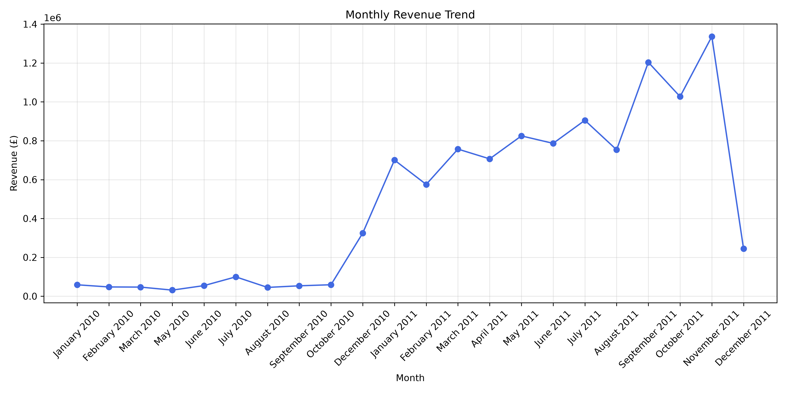
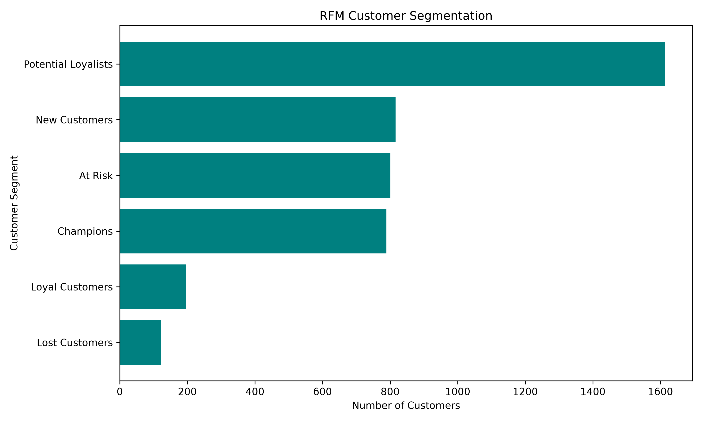

# Online Retail Sales and Customer Analysis

## Project Overview

An end-to-end data analysis project using Python to analyze
online retail transactions, identify sales trends, evaluate
product performance, understand customer purchasing behavior,
and provide actionable business recommendations.

## Tools and Technologies

- Python
- Pandas
- NumPy
- Matplotlib
- Visual Studio Code

## Dataset

- Source: UCI Machine Learning Repository - Online Retail
- Original records: 541,909
- Cleaned records: 524,878
- Original columns: 8
- Period: December 2010 to December 2011
- Currency: GBP (£)

Dataset link:
https://archive.ics.uci.edu/dataset/352/online+retail

## Project Objectives

- Clean and preprocess raw transactional data.
- Calculate key business performance indicators.
- Analyze country-wise and product-wise sales.
- Identify monthly, daily and hourly sales trends.
- Analyze customer purchasing behavior.
- Perform RFM customer segmentation.
- Generate statistical insights and visualizations.

## Data Cleaning

- Examined missing values and duplicate records.
- Removed cancelled transactions.
- Excluded non-positive quantities and unit prices.
- Removed exact duplicate records.
- Converted invoice dates into datetime format.
- Created revenue and date-related features.
- Retained missing customer IDs for revenue analysis.

## Key Performance Indicators

| Metric | Value |
|---|---:|
| Total Sales Revenue (before returns) | £10,666,684.54 |
| Total Units Sold | 5,588,376 |
| Total Orders | 19,960 |
| Average Order Value | £534.40 |
| Identified Customers | 4,338 |

## Exploratory Data Analysis

- Country-wise revenue and sales contribution.
- Product revenue and quantity ranking.
- Average selling price analysis.
- Monthly revenue and month-over-month growth.
- Daily and hourly sales performance.
- Customer spending and purchasing frequency.
- Repeat versus one-time customer analysis.

## RFM Customer Segmentation

Customers were segmented using three metrics:

- Recency: Days since the last purchase.
- Frequency: Number of unique orders.
- Monetary: Total customer spending.

Customer segments:

- Champions
- Loyal Customers
- Potential Loyalists
- New Customers
- At Risk
- Lost Customers
- Regular Customers

## Statistical Analysis

NumPy was used to calculate:

- Mean and median order values
- Standard deviation and variance
- Minimum and maximum order values
- 25th and 75th percentiles

## Data Visualizations

### Monthly Revenue Trend



### Country-wise Revenue


### Top 10 Products by Revenue


### Repeat vs One-time Customers


### RFM Customer Segmentation



### Order Value Distribution


## Key Business Insights

- The United Kingdom contributes approximately 84.61%
  of total sales revenue.
- The business generated approximately £10.67 million
  in positive sales revenue before returns.
- Product revenue and quantity rankings help identify
  differences in product performance.
- Customer segmentation enables targeted marketing
  and retention strategies.

## Business Recommendations

- Explore international market expansion to reduce
  dependency on the UK market.
- Introduce loyalty programs for repeat customers.
- Develop personalized campaigns for high-value customers.
- Implement reactivation campaigns for at-risk customers.
- Optimize inventory based on seasonal sales patterns.
- Review product pricing and sales performance.

## Project Limitations

- Missing customer IDs were excluded from customer analysis.
- December 2011 contains incomplete monthly data.
- Revenue excludes returns and cancelled transactions.
- Exact duplicate records were assumed to be redundant.
- Product cost information is unavailable, preventing
  profitability analysis.
- RFM frequency scoring may assign different scores
  to customers with identical order frequencies.

## How to Run the Project

1. Download the repository.
2. Download the dataset from the provided source.
3. Convert the dataset to CSV and name it online retail.csv.
4. Place the CSV file in the project folder.
5. Install the required dependencies:

```bash
pip install -r requirements.txt
```

6. Run the Python script:

```bash
python online_retail_analysis.py
```

## Skills Demonstrated

Data Cleaning, Exploratory Data Analysis, Python,
Pandas, NumPy, Data Visualization, Statistical Analysis,
Customer Segmentation and Business Analysis.

## Author

Anil Kumar
Aspiring Data Analyst
